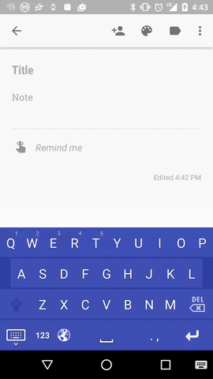

# AndroidCustomKeyboard

Android custom keyboard with predictive text.



## Setup

The keyboard has to be enabled in the system settings and selected as the default
keyboard. Android does not allow an app to do that on its own, so the app guides
the user through it: the first time it is opened it offers the setup, and
everything after enabling the keyboard (default keyboard + languages + dictionary)
is done automatically.

The permission `WRITE_SECURE_SETTINGS` is only a convenience for development. It
is a system permission, a normal installation never gets it, so the released app
always uses the guided flow. For development the whole setup can be done from the
command line:

```
tools\setup-keyboard.bat
```

The script grants `WRITE_SECURE_SETTINGS` (so the app can enable and select
itself without user interaction) and enables the keyboard. The grant is lost
when the app is uninstalled, so the script has to be run again after every
`adb install`.

Without the grant the equivalent commands are:

```
adb shell pm grant com.frisian.keyboard android.permission.WRITE_SECURE_SETTINGS
adb shell ime enable com.frisian.keyboard/.SoftKeyboard
adb shell ime set com.frisian.keyboard/.SoftKeyboard
```

## Dictionary

The dictionary is a SQLite database in `app/src/main/assets/dictionary.db` with one
table per language. It is installed automatically when it is missing or when its
version does not match the app version (`R.string.version`). Because of that the
version inside the database and `R.string.version` have to be bumped together.
